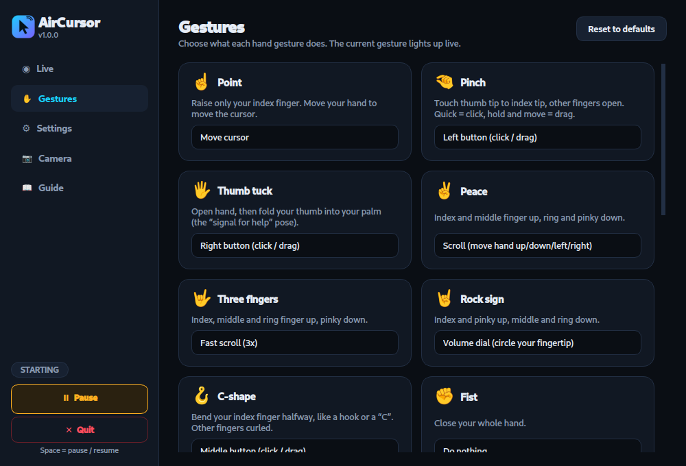

<div align="center">

# AirCursor

**Control your computer — or your phone — with your bare hand. No mouse. No gloves. Just a camera.**

Point to move · pinch to click · fist to rest · circle your finger to change the volume

[](https://github.com/Sanjarbek-2007/airmouse/actions/workflows/ci.yml)
[](https://github.com/Sanjarbek-2007/airmouse/releases/latest)
[](LICENSE)
[](#download)

[**⬇ Download**](#download) · [Desktop app](desktop/) · [Android app](mobile/) · [Gesture reference](docs/GESTURES.md) · [How it works](docs/ARCHITECTURE.md)



</div>

---

## Why AirCursor

* **Works like a mouse, not like a laser pointer.** Only hand *motion* matters, so you can rest your hand anywhere, lift it (open palm) and carry on. No reaching across the camera's field of view.
* **Hand-size-aware motion.** The cursor follows your hand 1:1 and feels the same near or far from the camera. Optional *speed-up* and *long-reach boost* sliders add extra travel on fast / sustained moves for reaching corners (off by default).
* **Hard to misfire.** A gesture must hold steady for a split second before it counts, the cursor freezes while a click is being recognised, a **fist never clicks**, and a safety guard auto-pauses if it ever sees a burst of clicks.
* **Impossible to lose.** An always-on-top panic panel (Pause / Quit) on every workspace; `aircursor ctl toggle` from any shortcut; launching the app twice just raises the running one. On Android: floating panel, notification buttons, and **Volume Up + Down = pause**.
* **Every gesture is remappable**, and the defaults are tuned to feel right out of the box.
* **Any camera.** Built-in webcam by default; or stream from a phone (IP Webcam) over Wi-Fi.
* **Private.** Everything runs on-device. Video is never recorded or uploaded.

## The two apps

| | Desktop | Android |
|---|---|---|
| Folder | [`desktop/`](desktop/) | [`mobile/`](mobile/) |
| Stack | Python · MediaPipe · PySide6 (Qt) | React Native · Kotlin · MediaPipe · CameraX |
| Controls | your computer's mouse, scroll wheel, volume | your phone's touch, scroll, Back/Home, volume |
| How | virtual mouse via `/dev/uinput` (works on **Wayland and X11**) | accessibility service + foreground camera service (works **in the background**) |
| Status | ✅ tested on Ubuntu / GNOME Wayland · Windows & macOS: experimental | ⚠️ **beta**: builds, installs and launches on a real phone; hand control still needs wider device testing |

Both share the same gesture vocabulary and the same recognition logic ([spec](docs/GESTURES.md)).

## Download

No build tools needed. Grab the files from the **[latest release](https://github.com/Sanjarbek-2007/airmouse/releases/latest)**.

### Android: install the APK (about 40 MB)

1. Download **`AirCursor-<version>-android.apk`** on your phone (or download it on a computer and copy it over).
2. Open it and allow *Install unknown apps* for your browser / file manager when Android asks.
3. Open **AirCursor** → **Setup**: allow the camera and notifications.
4. **Accessibility service → Open**, switch **AirCursor** on. If Android says the setting is *restricted*:
   *Settings → Apps → AirCursor → ⋮ → Allow restricted settings*, then try again.
5. Back in the app, tap **Start hand control**. Prop the phone up and use your other hand in front of the camera.

Android 8+ (API 26), 64-bit ARM phones. Prefer the command line? `adb install -r AirCursor-*.apk`.
It is a *beta*: please [report what works and what doesn't](https://github.com/Sanjarbek-2007/airmouse/issues/new/choose).

### Desktop: Linux (no Python needed)

```bash
tar xzf AirCursor-<version>-linux-x86_64.tar.gz
cd AirCursor-<version>-linux-x86_64
./install.sh        # one time: cursor permission (asks for sudo) + app-menu entry
./aircursor         # or search "AirCursor" in your app menu
```

Raise your index finger and move. Pinch to click. Press **Space** to pause. Everything is inside the folder,
including the hand-tracking model, so it works offline. Full guide: [desktop/README.md](desktop/README.md).

> **Windows** builds are produced by CI and attached to releases when available (`.zip`, experimental).
> macOS: run from source for now. Details in [desktop/README.md](desktop/README.md).

### Build from source

```bash
git clone https://github.com/Sanjarbek-2007/airmouse.git && cd airmouse

# Desktop (Python 3.9-3.12)
cd desktop && ./scripts/setup-linux.sh && ./run.sh

# Android (needs Node 22, JDK 17, Android SDK + NDK; see mobile/README.md)
cd mobile && npm install && cd android && ./gradlew assembleRelease     # -> app/build/outputs/apk/release/
```

## Default gestures

| | Gesture | Desktop | Android |
|---|---|---|---|
| ☝️ | Point | Move cursor | Move cursor |
| 🤏 | Pinch | Left click / drag | Tap / touch-and-drag |
| 🖐️ | Thumb tuck ("signal for help") | Right click / drag | Back |
| ✌️ | Peace + move hand | Scroll | Scroll |
| 🤟 | Three fingers + move hand | Fast scroll | Fast scroll |
| 🤘 | Rock sign + circle fingertip | Volume dial (10 % per turn) | Volume dial |
| ✊ | Fist | Rest (never clicks) | Rest |
| ✋ | Open palm | Lift the "mouse" | Lift the "mouse" |

## Repository layout

```
desktop/   Python app: engine, Qt GUI, CLI, packaging      (pytest — 56 tests)
mobile/    React Native app + Kotlin native layer          (jest — 13 tests, JUnit — 18 tests)
docs/      Gesture spec and architecture notes
```

## Tests

```bash
cd desktop && .venv/bin/python -m pytest          # gesture engine, safety, config, GUI (offscreen)
cd mobile  && npm run check                       # typecheck + lint + jest
cd mobile/android && ./gradlew testDebugUnitTest  # Kotlin engine (same scenarios as the Python tests)
```

## Roadmap

- [x] Downloadable Android APK and Linux desktop build
- [ ] Verify the Android app on more real devices; Play Store / F-Droid release with a proper signing key
- [ ] iOS (the gesture engine is plain Swift-portable logic; control APIs are the hard part)
- [ ] Windows / macOS hardening and installers (a Windows build is already produced by CI)
- [ ] Two-handed gestures, custom gesture recording
- [ ] Cursor-position-aware edge boost (needs OS cursor readback)

## Contributing

Issues and PRs are welcome — see [CONTRIBUTING.md](CONTRIBUTING.md). If AirCursor is useful to you, a ⭐ helps others find it.

## License

[MIT](LICENSE)
